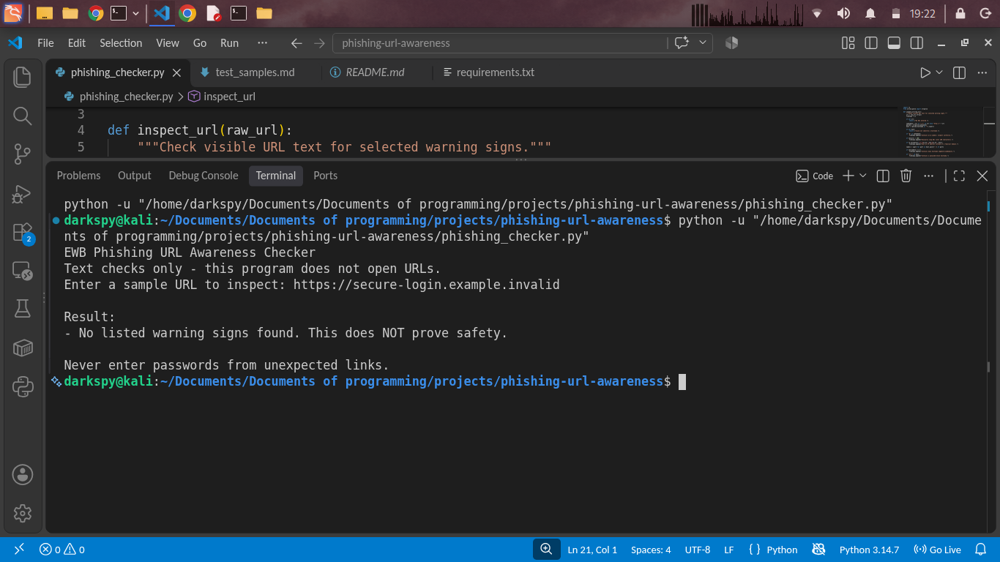
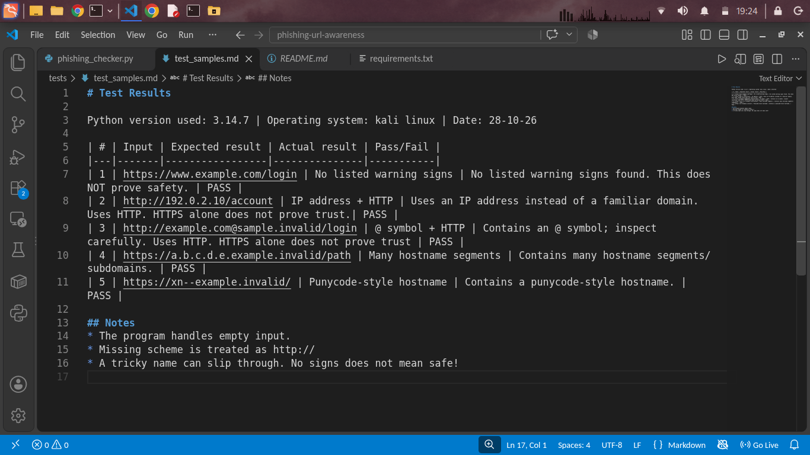

# EWB Phishing URL Awareness Checker

## Overview
Phishing is a trick where scammers send fake links or messages that look like they’re from a bank or a trusted company, hoping you’ll give away passwords, card details or OTPs. For this project, I built a Python tool that checks a URL’s text for warning signs, like an @ symbol, a very long link, an IP address, too many subdomains, punycode, or plain HTTP. It never opens the link. It also can’t prove a link is safe, because no warnings never means no danger.

## Features
- Detects an @ symbol in the URL
- Flags unusually long URLs (over 100 characters)
- Flags IP-address hostnames
- Flags many hostname segments (5 or more)
- Flags punycode-style hostnames (xn--)
- Flags the HTTP scheme
- Checks multiple URLs whithout Restarting the whole program.
- Can handle malformed URLs.

## Requirements
Python 3.10 or later. No extra packages.

## How to Run
Windows: python phishing_checker.py
Mac/Linux: python3 phishing_checker.py

## Example Output
Enter a sample URL (or type q to quit): http://192.0.2.10/account 

Result:
- Uses an IP address instead of a familiar domain.
- Uses HTTP. HTTPS alone does not prove trust.
Never enter passwords from unexpected links.

## Testing
| # | Input | Expected | Actual | Result |
|---|-------|----------|--------|--------|
| 1 | https://www.example.com/login | No listed warning signs | No listed warning signs found. This does NOT prove safety. | PASS |
| 2 | http://192.0.2.10/account | IP address + HTTP | Uses an IP address instead of a familiar domain. Uses HTTP. HTTPS alone does not prove trust.| PASS |
| 3 | http://example.com@sample.invalid/login | @ symbol + HTTP | Contains an @ symbol; inspect carefully. Uses HTTP. HTTPS alone does not prove trust | PASS |
| 4 | https://a.b.c.d.e.example.invalid/path | Many hostname segments | Contains many hostname segments/subdomains. | PASS |
| 5 | https://xn--example.invalid/ | Punycode-style hostname | Contains a punycode-style hostname. | PASS |

## Screenshots

## Improvements
1. Loop with quit - The program now works with a loop condition, you can check serveral URLs without starting the program again. Before, after checking one single URL, the program would get terminated.
2. Stop crashes on malformed input - The program won't exit on malformed input. Before, typing an invalid input like http://[google would throw a ValueError which is now replaced by a simple "This text is not a valid URL format." message. 

## Limitations
This is an educational tool. It only reads URL text. It does not visit
URLs, scan for malware or prove that a URL is safe. No warning signs
found does NOT mean a URL is safe.

## Ethical Use
Use sample strings only. Do not collect credentials. Do not use this
project to deceive anyone or to test websites without permission.

## Author
Pragati Bhandari, AI Powered CyberSecurity, EWB Courses
